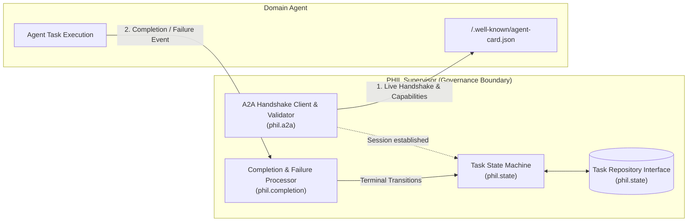
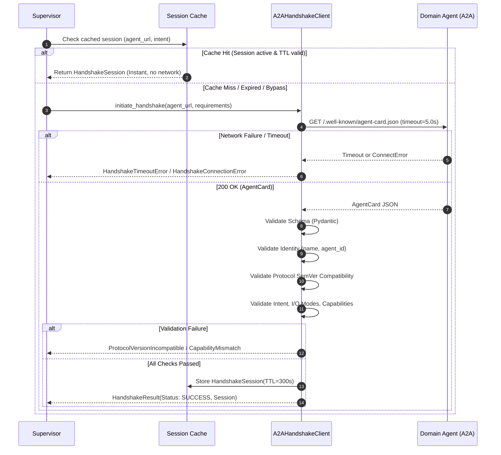
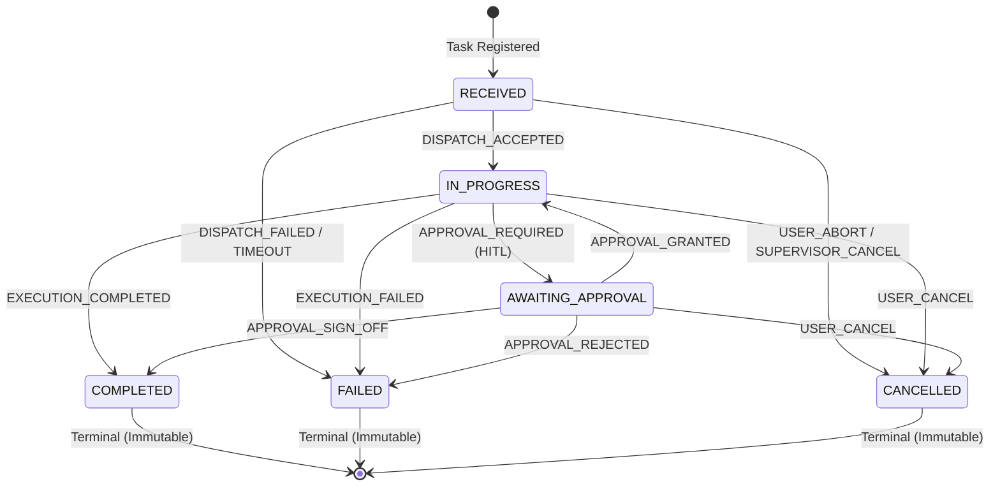

# PHIL AI Governance Platform – Sprint 3 Architecture & Handover Documentation

**Sprint:** Sprint 3 – Supervisor Handshake and State/Completion Contract  
**Story Points:** 3  
**Status:** Completed & Tested (45/45 Passing Tests)  
**Author:** Senior Python Engineer – PHIL AI Governance Team  

---

## 1. Architecture and Component Responsibilities

Sprint 3 implements three core, decoupled components forming the boundary between the **PHIL Supervisor** and external **Domain Agents**:



### Component Responsibilities:

1. **A2A Handshake Client (`phil.a2a`)**:
   - Retrieves and parses machine-readable `AgentCard` manifests from domain agent endpoints (`/.well-known/agent-card.json`).
   - Validates agent identity, protocol version compatibility range, and requested intent/capabilities (e.g. streaming, I/O MIME modes).
   - Manages an in-memory session cache with TTL to eliminate redundant network roundtrips for repeated queries.
   - Enforces configurable network timeouts and returns structured `HandshakeResult` or typed exceptions.

2. **Supervisor Task State Manager (`phil.state`)**:
   - Owns the authoritative PHIL task lifecycle: `RECEIVED`, `IN_PROGRESS`, `AWAITING_APPROVAL`, `COMPLETED`, `FAILED`, `CANCELLED`.
   - Enforces an immutable transition matrix; invalid transitions raise `InvalidStateTransitionError`.
   - Maintains an append-only audit trail (`history`) with timestamp, actor, trigger, and contextual reasons on each `PhilTask`.
   - Provides an abstract persistence interface (`TaskRepository`) and thread-safe implementation (`InMemoryTaskRepository`).
   - Maps standard A2A task lifecycle statuses (`submitted`, `working`, `input_required`, `completed`, `failed`, `cancelled`) to PHIL task states.

3. **Completion & Failure Contract Processor (`phil.completion`)**:
   - Validates incoming `TaskCompletionEvent` and `TaskFailureEvent` against strict Pydantic schemas.
   - Enforces multi-tenant correlation integrity (`correlation_id` matching).
   - Implements two-level idempotency protection:
     * Level 1: Event ID deduplication cache (`IGNORED_DUPLICATE`).
     * Level 2: State-level terminal idempotency checks (`ALREADY_PROCESSED`).
   - Emits structured `CompletionAck` responses back to the domain agent or message dispatcher.

---

## 2. A2A Handshake Flow

The A2A Handshake establishes runtime compatibility and liveness between the Supervisor and Domain Agents.



### Why We Handshake with Domain Agent Endpoints
* **Artifact Registry (Design-time / Static)**: Confirms that an agent was certified, registered, and authorized by the enterprise governance team.
* **A2A Endpoint (Runtime / Dynamic)**: Confirms that the target agent instance is alive, healthy, and ready to accept the specific intent on its active protocol binding URL.
* **Session Caching**: Handshakes do not repeat on every request; sessions are cached for a configurable duration (default 300s).

---

## 3. Registry and Certification Integration Assumptions

* **Artifact Registry**: Owned by another platform team. Stores agent artifacts and static metadata manifests. In Sprint 3, references to artifacts are represented by URI strings (e.g., `phil://artifacts/reports/ledger-audit.json`).
* **Governance Certification**: Handled by existing PHIL governance services. Domain agents may include a `certification_id` (e.g., `PHIL-CERT-2026-9921`) in their `AgentCard`. The Handshake client parses and preserves this identifier in the `HandshakeSession` for downstream audit verification.
* **No Direct Registry Service Implementation**: Per Sprint 3 boundaries, no database or registry service is implemented.

---

## 4. User Authorization Context

* **Upstream Authentication & Authorization**: Handled upstream by API Gateway / PHIL identity services before requests reach the Supervisor.
* **Traceable Context**: Each task accepted by the Supervisor includes:
  - `correlation_id`: Propagated from the user session or request context across all subagents.
  - `actor`: Logged in `StateTransitionRecord` when state transitions are triggered (e.g., `EndUser`, `ManagerUser`, `Supervisor`, `DomainAgent`).
* **HITL Approvals**: Human-in-the-loop decisions require an approver identity (`approved_by`) and decision reason stored in `ApprovalContext`.

---

## 5. Agent Discovery and Routing Context

* **Upstream Routing**: The agent routing engine (or user intent classifier) selects the candidate Domain Agent and provides its base URL (e.g. `https://agents.internal/finance`) and target `intent` to the Supervisor.
* **Runtime Binding**: The Supervisor takes this routing output, verifies the endpoint via `A2AHandshakeClient`, and records the resulting `agent_id` on the authoritative `PhilTask`.

---

## 6. Task Lifecycle and State Mapping

### 6.1 State Transition Matrix



### 6.2 A2A Status to PHIL State Mapping Table

| Incoming A2A Status | Authoritative PHIL State | Audit Trigger Recorded | Governance Significance |
|---|---|---|---|
| `submitted`, `queued`, `pending` | `TaskState.RECEIVED` | `A2A_SUBMITTED` | Task enqueued at domain agent |
| `working`, `in_progress`, `running` | `TaskState.IN_PROGRESS` | `A2A_WORKING` | Domain agent processing |
| `input_required`, `approval_required`, `human_in_the_loop` | `TaskState.AWAITING_APPROVAL` | `A2A_APPROVAL_REQUIRED` | Paused at governance / HITL gate |
| `completed`, `success`, `done` | `TaskState.COMPLETED` | `A2A_COMPLETED` | Outcome verified with result URI |
| `failed`, `error` | `TaskState.FAILED` | `A2A_FAILED` | Error recorded with diagnostic payload |
| `cancelled`, `canceled`, `aborted` | `TaskState.CANCELLED` | `A2A_CANCELLED` | Aborted by user or supervisor |

---

## 7. Completion and Failure Contracts

### 7.1 Event Models

* **`TaskCompletionEvent`**:
  ```python
  class TaskCompletionEvent(BaseModel):
      event_id: str          # Unique UUID for the delivery attempt
      task_id: str           # Target PHIL task ID
      correlation_id: str    # Upstream correlation ID
      timestamp: datetime    # UTC timestamp
      result_reference: str  # URI pointer to artifact in registry
      output_payload: Optional[Dict[str, Any]]
      metadata: Dict[str, Any]
  ```

* **`TaskFailureEvent`**:
  ```python
  class TaskFailureEvent(BaseModel):
      event_id: str          # Unique UUID for the delivery attempt
      task_id: str           # Target PHIL task ID
      correlation_id: str    # Upstream correlation ID
      timestamp: datetime    # UTC timestamp
      error_code: str        # Machine-readable error code
      error_message: str     # Diagnostic human-readable message
      details: Optional[Dict[str, Any]]
      retryable: bool        # Flag indicating if supervisor may retry
      metadata: Dict[str, Any]
  ```

* **`CompletionAck`**:
  ```python
  class CompletionAck(BaseModel):
      ack_id: str            # Unique acknowledgement ID
      event_id: str          # Original event ID acknowledged
      task_id: str           # Target PHIL task ID
      status: AckStatus      # PROCESSED | ALREADY_PROCESSED | IGNORED_DUPLICATE | ...
      timestamp: datetime
      message: str
      final_state: Optional[TaskState]
  ```

### 7.2 Idempotency & Deduplication Logic

1. **Deduplication by `event_id`**: If an event with the same `event_id` is re-delivered, the processor recognizes it instantly and returns `AckStatus.IGNORED_DUPLICATE` without re-evaluating or re-mutating task state.
2. **Task Validation**: Validates that `task_id` exists (`TASK_NOT_FOUND`) and matches the task's `correlation_id` (`CORRELATION_MISMATCH`).
3. **Terminal State Idempotency**:
   - If a completion event arrives for a task already in `COMPLETED` state:
     * If `result_reference` matches: returns `AckStatus.ALREADY_PROCESSED`.
     * If `result_reference` conflicts: returns `AckStatus.INVALID_TRANSITION`.
   - If an event arrives for an already `CANCELLED` task: returns `AckStatus.INVALID_TRANSITION`.

---

## 8. Error Handling and Timeout Behaviour

| Error Scenario | Exception / Ack Status | System Behavior |
|---|---|---|
| Domain agent unreachable or connection refused | `HandshakeConnectionError` | Returns connection error details; task stays in `RECEIVED` or transitions to `FAILED`. |
| Domain agent takes longer than `timeout_seconds` | `HandshakeTimeoutError` | Aborts request cleanly, prevents socket starvation; logs timeout. |
| Agent Card malformed or invalid JSON | `AgentCardMalformedError` | Prevents corrupted cards from polluting state; rejects agent. |
| Incompatible protocol version (e.g. v2.0 vs v1.0) | `ProtocolVersionIncompatibleError` | Rejects incompatible agent before dispatching any payloads. |
| Agent lacks requested intent or I/O mode | `CapabilityMismatchError` | Rejects mismatched agent; allows upstream router to pick alternative. |
| Illegal state transition (e.g. COMPLETED -> IN_PROGRESS) | `InvalidStateTransitionError` | Rejects transition, preserves state integrity, logs attempted illegal action. |
| Duplicate delivery of completion/failure event | `AckStatus.IGNORED_DUPLICATE` | Gracefully acknowledged without duplicate database writes or log pollution. |

---

## 9. Integration Examples and Execution Commands

### 9.1 Running Tests
```powershell
# Run the entire test suite with verbose output
$env:PYTHONPATH="src"; pytest tests/ -v

# Run only Handshake tests
$env:PYTHONPATH="src"; pytest tests/test_handshake.py -v

# Run only State Machine tests
$env:PYTHONPATH="src"; pytest tests/test_state_machine.py -v

# Run only Completion Contract tests
$env:PYTHONPATH="src"; pytest tests/test_completion.py -v
```

### 9.2 Python Integration Snippet

```python
import httpx
from phil.a2a import A2AHandshakeClient, HandshakeRequirements
from phil.state import (
    PhilTask,
    SupervisorTaskStateMachine,
    InMemoryTaskRepository,
    TaskState,
)
from phil.completion import CompletionProcessor, TaskCompletionEvent

# Setup
repo = InMemoryTaskRepository()
sm = SupervisorTaskStateMachine()
proc = CompletionProcessor(repository=repo, state_machine=sm)
client = A2AHandshakeClient(default_cache_ttl_seconds=300)

# 1. Handshake
req = HandshakeRequirements(required_intent="audit_records")
res = client.initiate_handshake("https://agents.internal/compliance", req)
assert res.status == "SUCCESS"

# 2. Register & Transition Task
task = PhilTask(
    correlation_id="corr-audit-001",
    agent_id=res.session.agent_id,
    intent="audit_records",
)
repo.save(task)
sm.transition(task, TaskState.IN_PROGRESS, trigger="DISPATCH")
repo.update(task)

# 3. Handle Completion
ack = proc.process_completion(
    TaskCompletionEvent(
        task_id=task.task_id,
        correlation_id=task.correlation_id,
        result_reference="phil://artifacts/audit-report-2026.pdf",
    )
)
assert ack.status == "PROCESSED"
```

---

## 10. Future Considerations (Separated from Current Implementation)

The following architectural items are identified for future platform sprints and are strictly separated from the current Sprint 3 scope:

1. **Persistent Distributed Storage**:
   - Implementation of PostgreSQL / Redis / DynamoDB backends for the `TaskRepository` interface.
2. **Distributed Deduplication Cache**:
   - Migration of the in-memory event deduplication set to distributed Redis with sliding-window TTLs for multi-pod supervisor deployments.
3. **Event Bus & Messaging Integrations**:
   - Integration with Kafka, RabbitMQ, or Cloud Pub/Sub for asynchronous event streaming and webhook deliveries.
4. **Automated Retry Policy Engine**:
   - Using the `retryable` flag on `TaskFailureEvent` to trigger exponential backoff retries with circuit breakers.
5. **Real-Time Notification Callbacks**:
   - SSE (Server-Sent Events) or WebSocket broadcasts of `StateTransitionRecord` events to supervisory monitoring dashboards.

