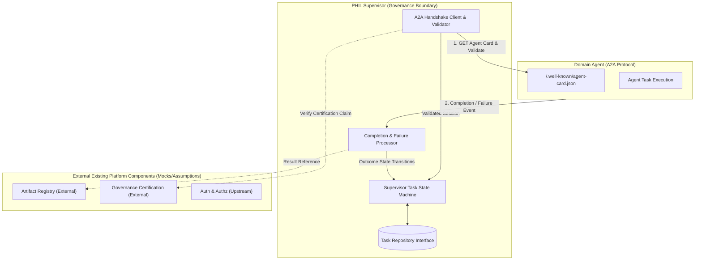
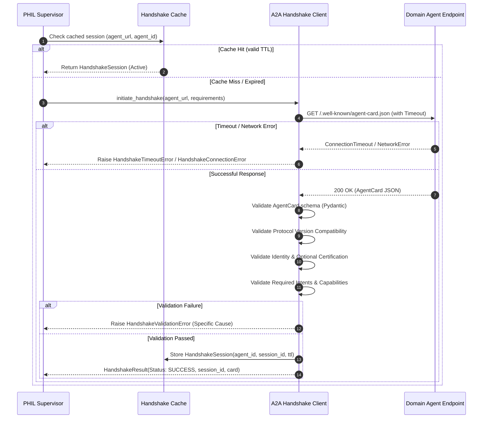
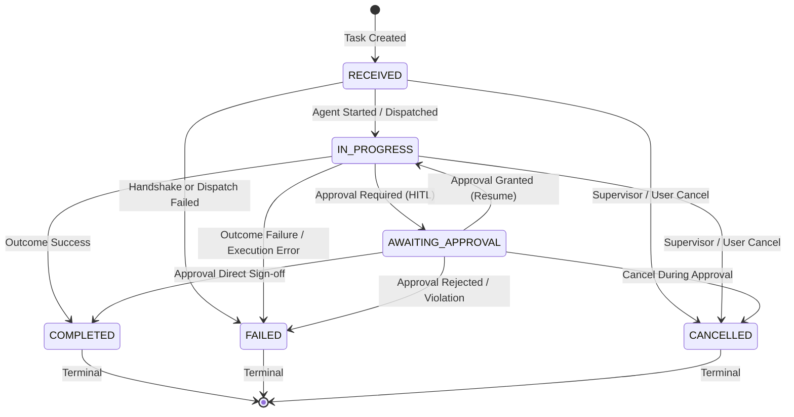
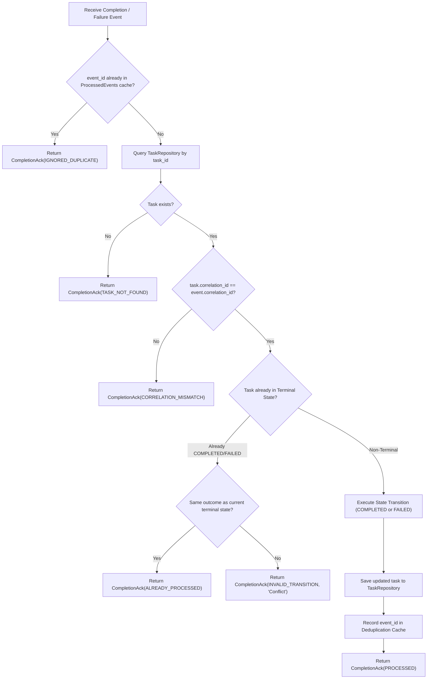

# PHIL Sprint 3: Architectural and Contract Design Specification (Stage 1)

**Version:** 1.0.0  
**Status:** Under Review (Awaiting User Approval)  
**Author:** Senior Python Engineer – PHIL AI Governance Team  
**Scope:** Sprint 3 – Handshake, Task State Management, Completion & Failure Contracts

---

## 1. Executive Summary & Architecture Overview

Sprint 3 implements the foundational governance and communication contracts between the **PHIL Supervisor** and external **Domain Agents** over the **Agent-to-Agent (A2A) Protocol**.

### 1.1 Strict Implementation Boundaries

In accordance with Sprint 3 constraints, the scope is strictly restricted to three modular, cohesive components:
1. **A2A Handshake & Validation Engine**: Establishing secure, compatible, and validated communication sessions with Domain Agents.
2. **Supervisor Task State Manager**: Authoritative PHIL-level task lifecycle state machine, permitted transitions, and persistence abstractions.
3. **Completion & Failure Contract Processor**: Idempotent processing, validation, duplicate handling, and acknowledgements for task completion and failure events.



### 1.2 Strict Exclusions
The following components are outside Sprint 3 and are not implemented:
* Artifact Registry service implementation (referenced via URIs only).
* Certification authority service.
* User authentication and authorization services (context passed upstream).
* Agent routing engine / LLM planner.
* Domain-agent internal business logic or workflows.
* LangGraph orchestration engine.
* Model Context Protocol (MCP) integrations.
* Heavy message brokers (Kafka/RabbitMQ) or production database infrastructure.

---

## 2. Implementation A: A2A Handshake Contract

### 2.1 Responsibilities
* Connects to Domain Agent A2A endpoints (default: `/.well-known/agent-card.json`).
* Parses and validates the **Agent Card** schema.
* Validates Agent Identity, domain matching, and optional certification assertions.
* Validates **Protocol Version Compatibility** using semantic versioning (e.g., A2A `^1.0.0` or `0.1.x`).
* Validates requested **Intents & Capabilities** (ensures required skill ID, input/output MIME modes, and streaming requirements are satisfied).
* Implements configurable network and request timeouts.
* Provides **Handshake Session Caching** with TTL to prevent redundant network handshakes for repeated user queries.

### 2.2 Sequence Flow



### 2.3 Schemas & Models

```python
class ProtocolBinding(BaseModel):
    protocol: Literal["http", "json-rpc", "grpc"]
    url: HttpUrl

class AgentSkill(BaseModel):
    id: str
    name: str
    description: str
    input_modes: List[str] = Field(default_factory=lambda: ["text/plain"])
    output_modes: List[str] = Field(default_factory=lambda: ["text/plain"])
    tags: List[str] = Field(default_factory=list)
    examples: List[str] = Field(default_factory=list)

class AgentCapabilities(BaseModel):
    streaming: bool = False
    push_notifications: bool = False
    state_recovery: bool = False

class AgentCard(BaseModel):
    name: str
    description: str
    version: str
    protocol_version: str = "1.0.0"
    skills: List[AgentSkill]
    capabilities: AgentCapabilities = Field(default_factory=AgentCapabilities)
    supported_interfaces: List[ProtocolBinding] = Field(default_factory=list)
    certification_id: Optional[str] = None
    metadata: Dict[str, Any] = Field(default_factory=dict)

class HandshakeRequirements(BaseModel):
    min_protocol_version: str = "1.0.0"
    max_protocol_version: str = "1.99.99"
    required_intent: str
    required_input_mode: str = "text/plain"
    required_output_mode: str = "text/plain"
    timeout_seconds: float = 5.0

class HandshakeSession(BaseModel):
    session_id: str
    agent_id: str
    agent_card: AgentCard
    validated_at: datetime
    expires_at: datetime
    matched_skill: AgentSkill
```

### 2.4 Error Taxonomy
* `HandshakeError` (Base exception)
* `HandshakeConnectionError`: Connection refused or DNS failure.
* `HandshakeTimeoutError`: Agent failed to respond within `timeout_seconds`.
* `AgentCardMalformedError`: JSON structure does not conform to A2A `AgentCard`.
* `ProtocolVersionIncompatibleError`: Protocol version out of supported range.
* `CapabilityMismatchError`: Agent lacks required intent, input mode, or output mode.

---

## 3. Implementation B: Supervisor Task State Management

### 3.1 PHIL Task Lifecycle States
The Supervisor owns the authoritative PHIL task state, defined as an enumeration:

* `RECEIVED`: Task registered at the Supervisor with unique `task_id` and `correlation_id`.
* `IN_PROGRESS`: Domain agent has accepted or is actively executing the task.
* `AWAITING_APPROVAL`: Task halted at a Human-in-the-Loop (HITL) or governance policy gate.
* `COMPLETED`: Terminal state indicating successful completion and verified outcome.
* `FAILED`: Terminal state indicating unrecoverable failure or policy violation.
* `CANCELLED`: Terminal state indicating user or supervisor initiated abort.

### 3.2 State Transition Matrix



| Source State | Permitted Destination States | Trigger / Event | Guard / Conditions |
|---|---|---|---|
| `RECEIVED` | `IN_PROGRESS` | `DISPATCH_ACCEPTED` | Valid handshake session exists |
| `RECEIVED` | `FAILED` | `DISPATCH_FAILED` | Agent unreachable or validation failed |
| `RECEIVED` | `CANCELLED` | `CANCEL_REQUESTED` | Caller authorized |
| `IN_PROGRESS` | `AWAITING_APPROVAL` | `APPROVAL_REQUIRED` | Approval context & reason attached |
| `IN_PROGRESS` | `COMPLETED` | `EXECUTION_COMPLETED` | Valid result reference provided |
| `IN_PROGRESS` | `FAILED` | `EXECUTION_FAILED` | Error code & message provided |
| `IN_PROGRESS` | `CANCELLED` | `CANCEL_REQUESTED` | Cancellation confirmed |
| `AWAITING_APPROVAL` | `IN_PROGRESS` | `APPROVAL_GRANTED` | Approver identity recorded |
| `AWAITING_APPROVAL` | `COMPLETED` | `APPROVAL_GRANTED_TERMINAL` | Approver approved final result |
| `AWAITING_APPROVAL` | `FAILED` | `APPROVAL_REJECTED` | Rejection reason recorded |
| `AWAITING_APPROVAL` | `CANCELLED` | `CANCEL_REQUESTED` | Abort pending approval |
| `COMPLETED` | *None* | *Terminal State* | Immutable |
| `FAILED` | *None* | *Terminal State* | Immutable |
| `CANCELLED` | *None* | *Terminal State* | Immutable |

### 3.3 A2A Status to PHIL State Mapping

A2A protocol events from Domain Agents are translated deterministically to authoritative PHIL states:

| A2A Protocol Status | PHIL Task State | Mapping Notes |
|---|---|---|
| `submitted`, `queued` | `RECEIVED` | Initial task submission acknowledged by domain agent |
| `working`, `in_progress` | `IN_PROGRESS` | Active execution underway |
| `input_required`, `approval_required` | `AWAITING_APPROVAL` | Domain agent paused waiting for governance or user approval |
| `completed`, `success` | `COMPLETED` | Final outcome verified with result reference |
| `failed`, `error` | `FAILED` | Error reported by agent or protocol runtime |
| `cancelled`, `canceled` | `CANCELLED` | Domain agent confirmed cancellation |

### 3.4 Task Model & Persistence Interface

```python
class TaskState(str, Enum):
    RECEIVED = "RECEIVED"
    IN_PROGRESS = "IN_PROGRESS"
    AWAITING_APPROVAL = "AWAITING_APPROVAL"
    COMPLETED = "COMPLETED"
    FAILED = "FAILED"
    CANCELLED = "CANCELLED"

class StateTransitionRecord(BaseModel):
    from_state: TaskState
    to_state: TaskState
    timestamp: datetime
    trigger: str
    actor: Optional[str] = None
    reason: Optional[str] = None

class PhilTask(BaseModel):
    task_id: str
    correlation_id: str
    agent_id: str
    intent: str
    state: TaskState = TaskState.RECEIVED
    history: List[StateTransitionRecord] = Field(default_factory=list)
    result_reference: Optional[str] = None
    error_info: Optional[Dict[str, Any]] = None
    approval_context: Optional[Dict[str, Any]] = None
    created_at: datetime = Field(default_factory=lambda: datetime.now(timezone.utc))
    updated_at: datetime = Field(default_factory=lambda: datetime.now(timezone.utc))

class TaskRepository(ABC):
    @abstractmethod
    async def get(self, task_id: str) -> Optional[PhilTask]: ...
    @abstractmethod
    async def save(self, task: PhilTask) -> None: ...
    @abstractmethod
    async def update(self, task: PhilTask) -> None: ...
```

---

## 4. Implementation C: Completion & Failure Contracts

### 4.1 Responsibilities
* Validates incoming completion and failure payloads against formal Pydantic schemas.
* Enforces strict correlation check: verifies `task_id` exists and incoming `correlation_id` matches.
* Guarantees **idempotent logical processing**:
  - Re-delivering the exact same completion or failure event returns an acknowledgement without duplicating state history or throwing fatal exceptions.
* Handles duplicate / late events safely:
  - If a task is already `COMPLETED` or `FAILED`, subsequent events are acknowledged with `AckStatus.ALREADY_PROCESSED` or `AckStatus.IGNORED_DUPLICATE`.
* Returns standardized `CompletionAck` responses.

### 4.2 Event Schemas

```python
class TaskCompletionEvent(BaseModel):
    event_id: str = Field(description="Unique UUID for this event delivery")
    task_id: str = Field(description="Target PHIL task identifier")
    correlation_id: str = Field(description="Correlation ID established at dispatch")
    timestamp: datetime = Field(default_factory=lambda: datetime.now(timezone.utc))
    result_reference: str = Field(description="URI or handle to registered artifact / outcome")
    output_payload: Optional[Dict[str, Any]] = None
    metadata: Dict[str, Any] = Field(default_factory=dict)

class TaskFailureEvent(BaseModel):
    event_id: str = Field(description="Unique UUID for this event delivery")
    task_id: str = Field(description="Target PHIL task identifier")
    correlation_id: str = Field(description="Correlation ID established at dispatch")
    timestamp: datetime = Field(default_factory=lambda: datetime.now(timezone.utc))
    error_code: str = Field(description="Machine-readable error category")
    error_message: str = Field(description="Human-readable description of the failure")
    details: Optional[Dict[str, Any]] = None
    retryable: bool = False
    metadata: Dict[str, Any] = Field(default_factory=dict)

class AckStatus(str, Enum):
    PROCESSED = "PROCESSED"
    ALREADY_PROCESSED = "ALREADY_PROCESSED"
    IGNORED_DUPLICATE = "IGNORED_DUPLICATE"
    TASK_NOT_FOUND = "TASK_NOT_FOUND"
    CORRELATION_MISMATCH = "CORRELATION_MISMATCH"
    INVALID_TRANSITION = "INVALID_TRANSITION"

class CompletionAck(BaseModel):
    ack_id: str
    event_id: str
    task_id: str
    status: AckStatus
    timestamp: datetime = Field(default_factory=lambda: datetime.now(timezone.utc))
    message: str
```

### 4.3 Idempotent Processing Flow



---

## 5. Technology Stack & Implementation Standards

| Category | Selection | Version / Specification | Justification |
|---|---|---|---|
| **Language** | Python | 3.14 / 3.11+ | Clean type hints, native async support |
| **Data Validation** | Pydantic | 2.12.5 | Fast schema validation, immutable models, standard A2A support |
| **HTTP Transport** | HTTPX | 0.28.1 | Async/sync HTTP client with robust timeout handling and `MockTransport` for tests |
| **Test Framework** | Pytest | 9.1.1 | Standardized testing, fixture support, hermetic execution |
| **A2A Protocol** | A2A Specification Models | Conforming to A2A 1.0.0 | Pure Pydantic A2A models ensuring zero fragile external network requirements |

---

## 6. Target Directory Layout

```
phil_goverance_02/
├── instruction.md
├── docs/
│   └── stage1_design_specification.md
├── src/
│   └── phil/
│       ├── __init__.py
│       ├── a2a/
│       │   ├── __init__.py
│       │   ├── models.py          # AgentCard, AgentSkill, HandshakeModels
│       │   ├── client.py          # A2AHandshakeClient with timeout & caching
│       │   └── exceptions.py      # HandshakeError hierarchy
│       ├── state/
│       │   ├── __init__.py
│       │   ├── models.py          # PhilTask, TaskState, StateTransitionRecord
│       │   ├── machine.py         # SupervisorTaskStateMachine & transition rules
│       │   ├── repository.py      # TaskRepository (ABC) & InMemoryTaskRepository
│       │   ├── mapper.py          # A2A outcome to PHIL state mapper
│       │   └── exceptions.py      # InvalidStateTransitionError
│       └── completion/
│           ├── __init__.py
│           ├── models.py          # TaskCompletionEvent, TaskFailureEvent, CompletionAck
│           └── processor.py       # CompletionProcessor (Idempotent handler & dedup)
└── tests/
    ├── __init__.py
    ├── test_handshake.py          # Handshake unit & timeout tests
    ├── test_state_machine.py      # State transition matrix & invalid transition tests
    └── test_completion.py         # Completion, failure, duplicate & idempotency tests
```

---

## 7. Next Steps & Approval Gate

As specified in Sprint 3 instructions:
> **"First action: Complete Stage 1 design only. Do not write code until the design is reviewed and approved."**

Upon user review and formal approval of this Stage 1 Design Specification, we will proceed to:
1. **Stage 2**: Implement A2A Handshake client, parsing, validation, caching, and tests.
2. **Stage 3**: Implement Supervisor Task state machine, repository interface, A2A state mapper, and tests.
3. **Stage 4**: Implement Completion and Failure contracts, idempotent processor, and tests.
4. **Stage 5**: Handover, integration verification, and documentation.

